# 分享一个思路，用AI搭建你的生活操作系统。

> 本文档由小红书笔记归档生成：正文、配图与可见评论。

## 笔记信息

- **标题**：分享一个思路，用AI搭建你的生活操作系统。
- **作者**：西里森森（userId: `6244a8f7000000001000ada3`）
- **笔记 ID**：`6a426275000000002003bd0f`
- **发布时间**：2026-06-29 22:17（图文页显示约 2026-06-27 01:40，IP/归属地：上海）
- **互动数据**：点赞 2,624 · 收藏 2,895 · 评论 97 · 分享 296
- **原链接**：http://xhslink.cn/o/9BFgVsmB2BY
- **完整链接**：https://www.xiaohongshu.com/explore/6a426275000000002003bd0f?xsec_token=CB3bW6UmkQkHzM8wmnbzDnNQ6rF7Xx5YsyUkNtkJZ-0bs=&xsec_source=app_share

## 正文

不知道大家今年有没有看到一个非常火的概念，叫Life OS，生活操作系统。

简单说，就是把企业管理的系统化思维搬到个人生活上来。

公司有CRM管客户、有BI看数据，个人为什么不能也有一套系统来管理自己的文件、知识和习惯？

已经有不少人在按这种方式实践了。
比如有一个叫叫 Dimitris Dimitriadis 的博主，他自己本身咨询顾问，同时写书、做演讲、管理跨国产品开发团队。

他在自己的blog上写过一篇很火的教程：用AI搭建你的「人生仪表盘」。
这是一个纯HTML文件，涵盖项目管理、邮件、日历、健身追踪、财务报表、阅读列表等等。
他用AI把生活各个板块用图表可视化了，搭建的全部成本仅花费大概51美元。

我看了一下，他的方案需对普通人来说门槛还是有点高。
那有没有更简单的方式来复刻这个「人生仪表盘」呢？

我尝试了非常多不同的AI工具，最终锁定了Marvis。

因为它跟很多其他AI工具不同的一点在于，它装在操作系统层级，能直接读你的磁盘、操作系统设置、搜索本地文件内容。

很多大佬的案例中需要写代码才能做到的事，用Marvis可以直接用自然语言让它去干，这也是我选择用它来落地Life OS的原因。

下面给大家分享一下，我用Marvis搭建生活操作系统的全流程

#Marvis #马维斯 #AI助手 #Marvis教程 #榨干设备howto #howto用AI手搓APP #howto实现一万种vibecoding #howto用AI抢救一切 #howto用好AI #AI人工智能

## 配图（共 13 张）

> 小红书图文的主要教程内容在图片里。下方按顺序嵌入原图，并附上图片文字整理。

### 图片 1

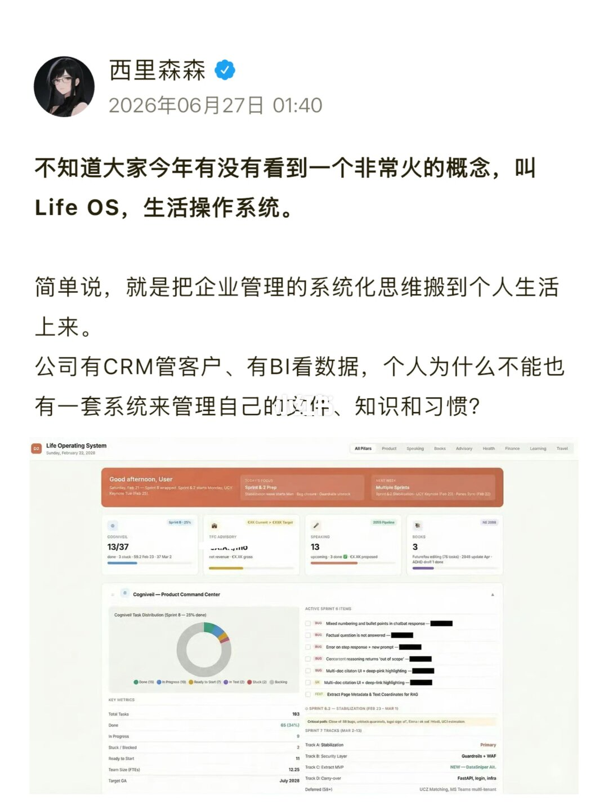

**图片文字整理：**

不知道大家今年有没有看到一个非常火的概念，叫 Life OS，生活操作系统。

简单说，就是把企业管理的系统化思维搬到个人生活上来。

公司有 CRM 管客户、有 BI 看数据，个人为什么不能也有一套系统来管理自己的文件、知识和习惯？

（附图：Dimitris 风格的 Life Operating System 仪表盘示意）

### 图片 2

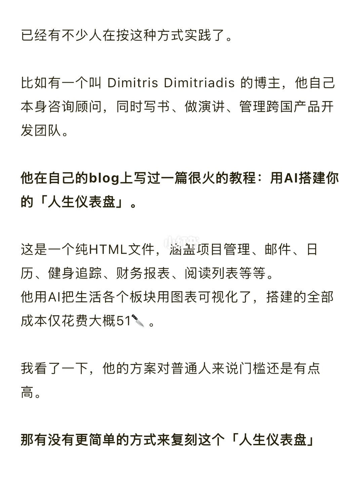

**图片文字整理：**

已经有不少人在按这种方式实践了。

比如有一个叫 Dimitris Dimitriadis 的博主，他自己本身咨询顾问，同时写书、做演讲、管理跨国产品开发团队。

他在自己的 blog 上写过一篇很火的教程：用 AI 搭建你的「人生仪表盘」。

这是一个纯 HTML 文件，涵盖项目管理、邮件、日历、健身追踪、财务报表、阅读列表等等。他用 AI 把生活各个板块用图表可视化了，搭建的全部成本仅花费大概 51 美元。

我看了一下，他的方案对普通人来说门槛还是有点高。

那有没有更简单的方式来复刻这个「人生仪表盘」？

### 图片 3

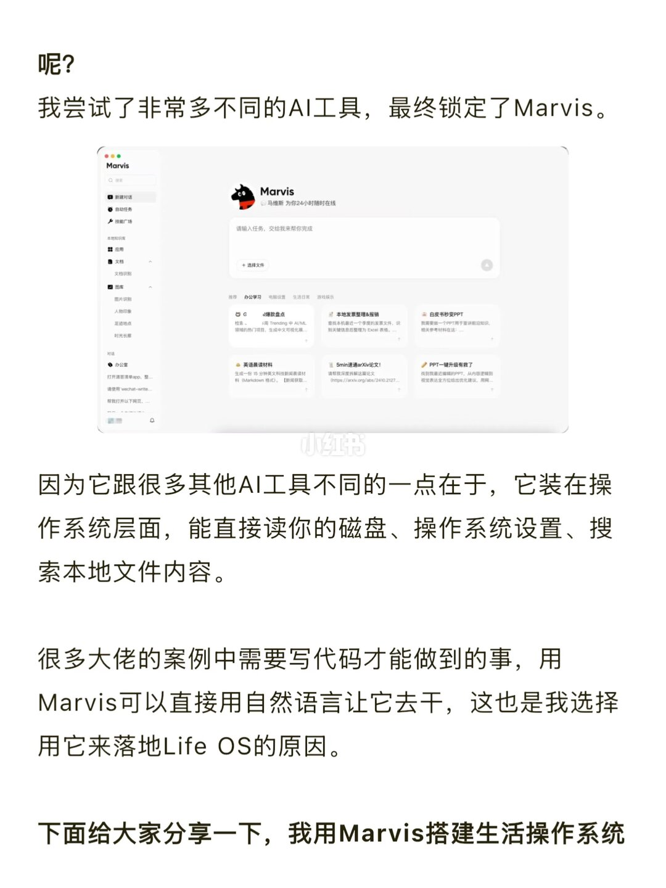

**图片文字整理：**

呢？我尝试了非常多不同的 AI 工具，最终锁定到了 Marvis。

（附图：Marvis 桌面端界面）

因为它跟很多其他 AI 工具不同的一点在于，它装在操作系统层面，能直接读你的磁盘、操作系统设置、搜索本地文件内容。

很多大佬的案例中需要写代码才能做到的事，用 Marvis 可以直接用自然语言让它去干，这也是我选择用它来落地 Life OS 的原因。下面给大家分享一下，我用 Marvis 搭建生活操作系统

### 图片 4

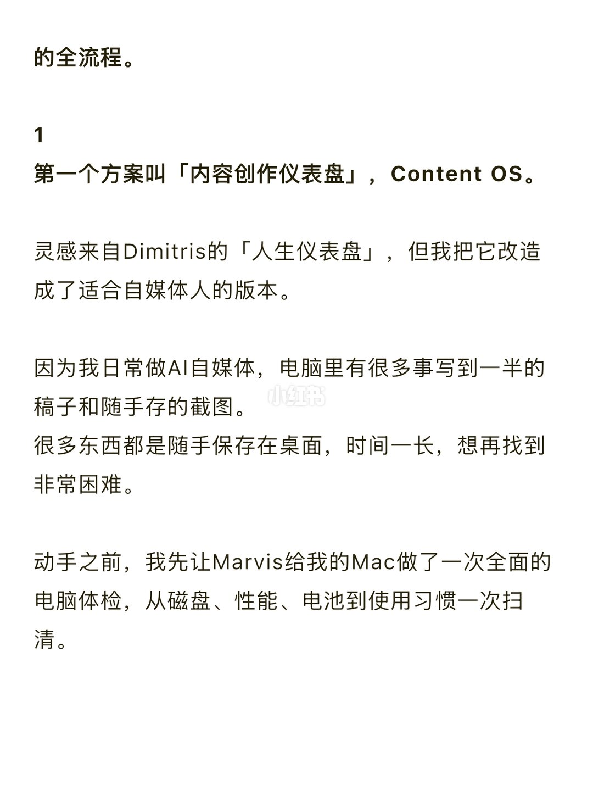

**图片文字整理：**

的全流程。

## 1. 内容创作仪表盘 / Content OS

第一个方案叫「内容创作仪表盘」，Content OS。

灵感来自 Dimitris 的「人生仪表盘」，但我把它改造成了适合自媒体人的版本。

因为我日常做 AI 自媒体，电脑里有很多写到一半的稿子和随手存的截图。

很多东西都是随手保存在桌面，时间一长，想再找到非常困难。

动手之前，我先让 Marvis 给我的 Mac 做了一次全面的电脑体检，从磁盘、性能、电池到使用习惯一次扫清。

### 图片 5

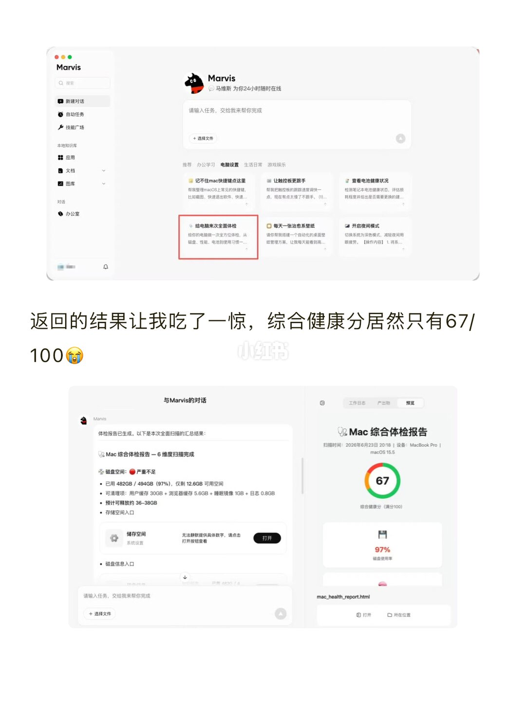

**图片文字整理：**

（附图：在 Marvis 中点击「给你的电脑做一次全面体检」）

返回的结果让我吃了一惊，综合健康分居然只有 67/100 😭

（附图：Mac 综合体检报告——磁盘 482GB/494GB、使用率 97%，仅剩 12.6GB）

### 图片 6

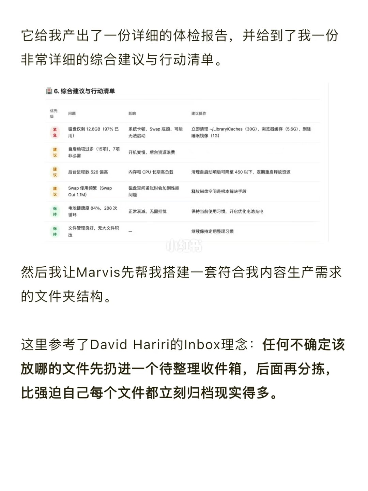

**图片文字整理：**

它给我产出了一份详细的体检报告，并给了我一份非常详细的综合建议与行动清单。

### 综合建议与行动清单（摘要）

| 优先级 | 问题 | 影响 | 建议操作 |
|---|---|---|---|
| 紧急 | 磁盘仅剩 12.6GB（97% 已用） | 系统卡顿、Swap 瓶颈、可能无法启动 | 立即清理 ~/Library/Caches（30G）、浏览器缓存（5.6G）、删除睡眠镜像（1G） |
| 建议 | 自启动项过多（15项），7项非必需；后台进程数 526 偏高 | 开机变慢、后台资源浪费；内存和 CPU 长期高负载 | 清理自启动项后可降至 450 以下，定期重启释放资源 |
| 建议 | Swap 使用频繁（Swap Out 1.1M） | 磁盘空间紧张时会加剧性能问题 | 释放磁盘空间是根本解决手段 |
| 保持 | 电池健康度 84%，288 次循环 | 正常衰减，无需担忧 | 保持当前使用习惯，开启优化电池充电 |
| 保持 | 文件管理良好，无大文件积压 | — | 继续保持定期整理习惯 |

然后我让 Marvis 先帮我搭建一套符合我内容生产需求的文件夹结构。

这里参考了 David Hariri 的 Inbox 理念：任何不确定该放哪的文件先扔进一个待整理收件箱，后面再分拣，比强迫自己每个文件都立刻归档现实得多。

### 图片 7

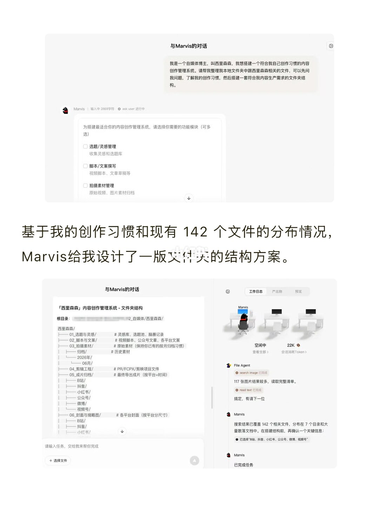

**图片文字整理：**

（附图：与 Marvis 对话——说明自己是自媒体博主「西里森森」，请它整理本地相关文件并设计文件夹结构）

Marvis 询问需要的功能模块（可多选）：
- 选题 / 灵感管理
- 脚本 / 文案撰写
- 拍摄素材管理

基于我的创作习惯和现有 142 个文件的分布情况，Marvis 给我设计了一版文件夹的结构方案。

### 文件夹结构方案（摘要）

```text
.../02_自媒体/西里森森/
├── 01_选题与灵感/      # 灵感库、选题池、脑暴记录
├── 02_脚本与文案/      # 视频脚本、公众号文章、平台文案
├── 03_拍摄素材/        # 原始素材（按月归档）
│   ├── 归档/
│   └── 2024年/06月/
├── 04_剪辑工程/        # PR / FCPX / 剪映项目工程
├── 05_成片归档/        # 最终导出成片（按平台+时间）
│   ├── B站/ 抖音/ 小红书/ 公众号/ 微博/ 视频号/
└── 06_封面与缩略图/    # 各平台封面（按平台分尺寸）
    ├── B站/ 抖音/ 小红书/
```

### 图片 8

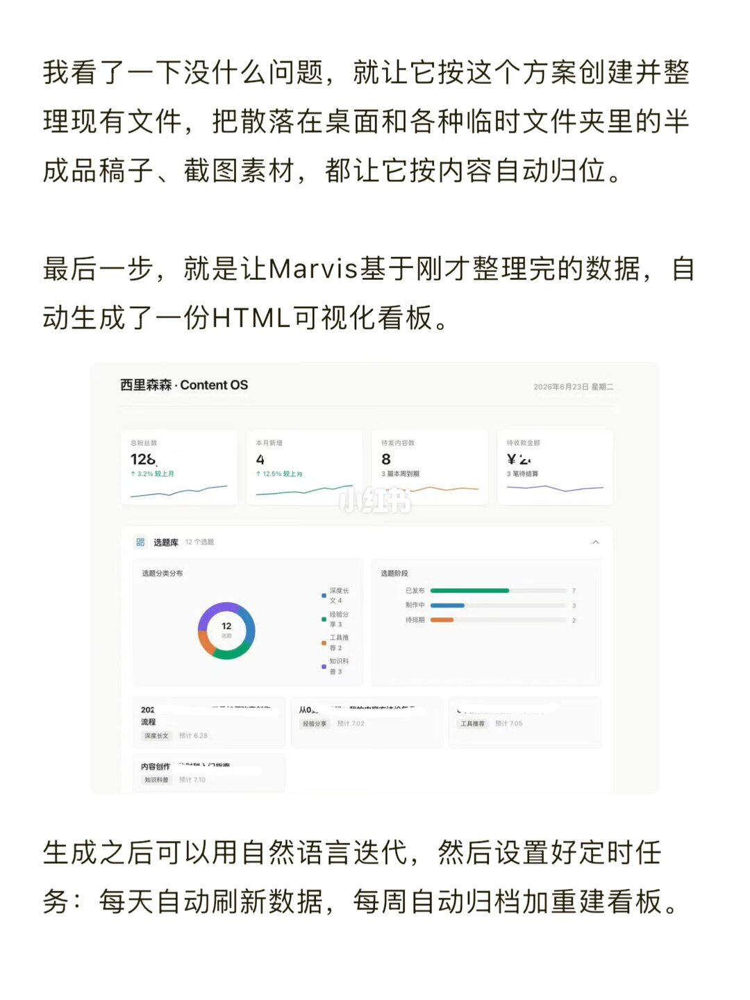

**图片文字整理：**

我看了一下没什么问题，就让它按这个方案创建并整理现有文件，把散落在桌面和各种临时文件夹里的半成品稿子、截图素材，都让它按内容自动归位。

最后一步，就是让 Marvis 基于刚才整理完的数据，自动生成了一份 HTML 可视化看板。

（附图：西里森森 · Content OS 看板——总粉丝、本月新增、待发布内容、待收收益、选题库分布等）

生成之后可以用自然语言迭代，然后设置好定时任务：每天自动刷新数据，每周自动归档加重建看板。

### 图片 9

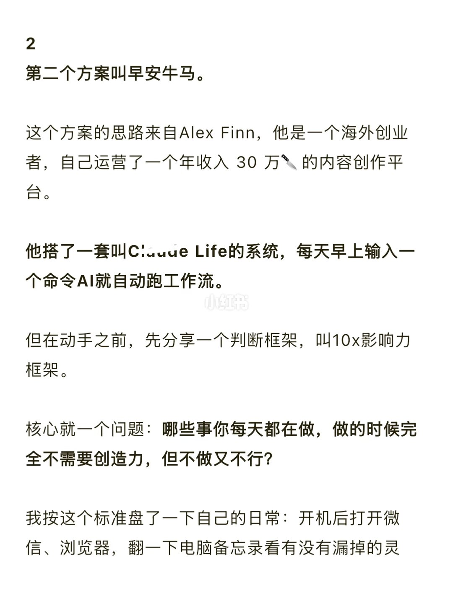

**图片文字整理：**

## 2. 早安牛马

第二个方案叫「早安牛马」。

这个方案的思路来自 Alex Finn，他是一个海外创业者，自己运营了一个年收入 30 万刀的内容创作平台。

他搭了一套叫 Claude Life 的系统，每天早上输入一个命令 AI 就自动跑工作流。

但在动手之前，先分享一个判断框架，叫 10x 影响力框架。

核心就一个问题：哪些事你每天都在做，做的时候完全不需要创造力，但不做又不行？

我按这个标准盘了一下自己的日常：开机后打开微信、浏览器，翻一下电脑备忘录看有没有漏掉的灵

### 图片 10

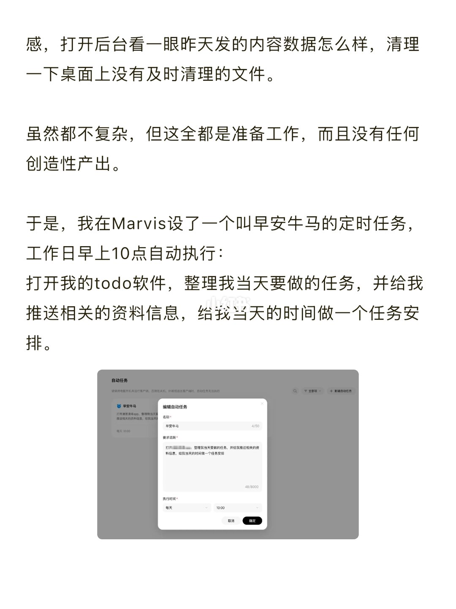

**图片文字整理：**

感，打开后台看一眼昨天发的内容数据怎么样，清理一下桌面上没有及时清理的文件。

虽然都不复杂，但这全都是准备工作，而且没有任何创造性产出。

于是，我在 Marvis 设了一个叫「早安牛马」的定时任务，工作日早上 10 点自动执行：打开我的 todo 软件，整理我当天要做的任务，并给我推送相关的资料信息，给我当天的时间做一个任务安排。

（附图：Marvis「编辑自动任务」——名称：早安牛马；执行时间：每天 10:00）

### 图片 11

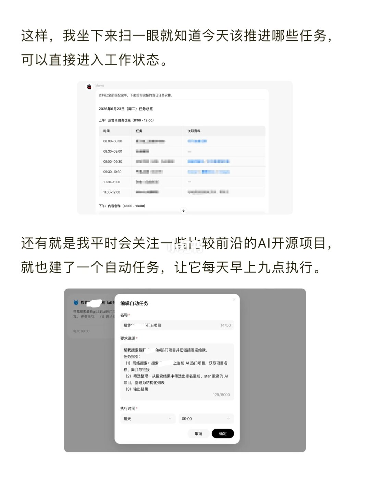

**图片文字整理：**

这样，我坐下来扫一眼就知道今天该推进哪些任务，可以直接进入工作状态。

（附图：当日任务总览——上午运营&财务优先，下午内容创作，并附关联资料链接）

还有就是我平时会关注一些比较前沿的 AI 开源项目，就也建了一个自动任务，让它每天早上九点执行。

（附图：编辑自动任务——搜索热门 AI 项目，每天 09:00）

### 图片 12

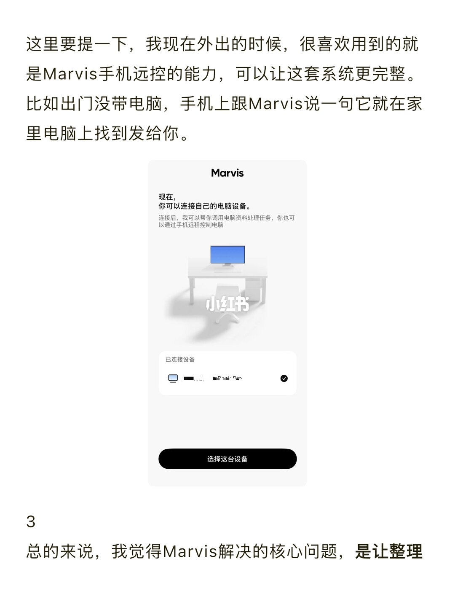

**图片文字整理：**

这里要提一下，我现在外出的时候，很喜欢用到的就是 Marvis 手机远控的能力，可以让这套系统更完整。

比如出门没带电脑，手机上跟 Marvis 说一句它就在家里电脑上找到发给你。

（附图：Marvis 手机端「已连接设备」界面）

## 3. 总结

总的来说，我觉得 Marvis 解决的核心问题，是让整理

### 图片 13

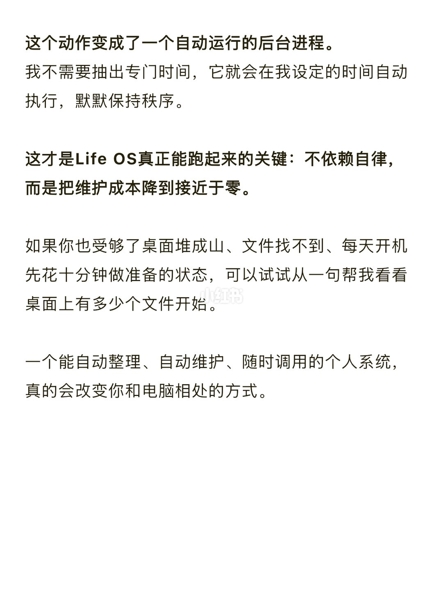

**图片文字整理：**

这个动作变成了一个自动运行的后台进程。

我不需要抽出专门时间，它就会在我设定的时间自动执行，默默保持秩序。

**这才是 Life OS 真正能跑起来的关键：不依赖自律，而是把维护成本降到接近于零。**

如果你也受够了桌面堆成山、文件找不到、每天开机先花十分钟做准备的状态，可以试试从一句「帮我看看桌面上有多少个文件」开始。

一个能自动整理、自动维护、随时调用的个人系统，真的会改变你和电脑相处的方式。

## 评论

> 官方显示共 **97** 条评论。未登录状态下接口仅返回首屏热门/最新评论，以下为本次抓取到的 **11** 条一级评论及其可见回复（可能不完整）。页面提示「登录查看全部评论内容」。

### 1. DDD

*2026-07-02 01:49 · IP:新加坡 · 赞:10+*

你们 Vibe Coding 的人没事干的话，可以去找个班上，不要再浪费数据中心的电力去做这种无聊的项目了

**回复：**

- **可可坚果**（2026-07-04 03:25 · IP:重庆 · 赞:5）：web3 同理
- **火腿肠吃鸡蛋了吗**（2026-07-05 11:28 · IP:浙江 · 赞:0）：@啵一下 😅😅
- **啵一下**（2026-07-05 13:15 · IP:山东 · 赞:0）：笑死我了
- …另有约 2 条回复未展开

### 2. momo

*2026-06-30 03:16 · IP:美国 · 赞:10+*

解决了在家不能上班的痛点

**回复：**

- **汉尼拔罐**（2026-06-30 07:17 · IP:美国 · 赞:10+）：好痛好痛
- **useleseeking**（2026-06-30 16:40 · IP:重庆 · 赞:0）：哈哈哈哈哈哈哈哈哈哈
- **小驴快跑ing_M**（2026-06-30 23:57 · IP:日本 · 赞:0）：哈哈哈哈，确实是
- …另有约 4 条回复未展开

### 3. Blackout

*2026-07-01 00:54 · IP:上海 · 赞:10+*

听我的，普通人没那么多数据要整理，每天也产生不了那么多有价值的数据，更没那个能力管理这样一个系统。

**回复：**

- **极个别同志**（2026-07-01 09:36 · IP:陕西 · 赞:10+）：是的，我曾试图搞一个，发现自己一天里没有多少事情需要管理，自己脑子过一遍也就几分钟都过完了
- **Blackout**（2026-07-01 21:12 · IP:上海 · 赞:5）：马斯克说的做事五步，最后一步才是自动化。现在有AI了变成了数据为自动化服务，完全本末倒置了。如果能精准裁切自己的需求以后反复迭代出来的路径才是最应该交给AI自动化的部分。可惜我们这些大众做不到这一点

### 4. ？？？

*2026-06-30 12:38 · IP:陕西 · 赞:10+*

职场嘉豪，把生活都搞成职场那一套糟粕

### 5. 染时

*2026-06-30 08:16 · IP:江苏 · 赞:10+*

不要把自己当工具用

**回复：**

- **Hsützu**（2026-07-05 03:38 · IP:浙江 · 赞:0）：@小羊偷牛奶🥛

### 6. momo

*2026-06-30 07:32 · IP:广东 · 赞:10+*

腾讯的东西，还要扫盘，反正我是不会用的🙂

**回复：**

- **momo123**（2026-06-30 09:18 · IP:湖北 · 赞:2）：腾讯的东西，不到逼不得已，是绝不会碰的。
- …另有约 1 条回复未展开

### 7. 猫砂盆操盘手

*2026-07-01 13:17 · IP:浙江 · 赞:9*

各种生活安排计划弄成什么系统化、sop、看板云云，干脆就别做人了做机器算了。ai热以来互联网给渲染成一种不流程化不体系化人就活不了的趋势，真的让我很反感。。

### 8. 鱼头泡饼

*2026-07-01 10:42 · IP:江苏 · 赞:9*

无聊

**回复：**

- **..**（2026-07-01 14:00 · IP:广东 · 赞:0）：然而高管有助理，所以其实没人需要
- …另有约 1 条回复未展开

### 9. 小红薯674686EE

*2026-07-05 23:54 · IP:广东 · 赞:1*

普通人要有松弛感不然活的很累

### 10. 兢兢葡萄

*2026-07-25 10:21 · IP:湖北 · 赞:0*

感觉用工具把人变成系统，就是一种把人异化成工具的方式，可能会造成任何事物都可以由算法决定的错觉，这会造成对自我的去责任化。可能久而久之会迷失。

### 11. 自然女小白

*2026-07-10 13:19 · IP:上海 · 赞:0*

@问一问 文中提到的软件能往obsidian里新建笔记吗，或者修改已有的笔记，请上网搜一下回答我

**回复：**

- **问一问**（2026-07-10 13:19 · 赞:0）：根据现有信息，笔记中提到的Marvis软件 本身并没有直接提及支持向Obsidian新建或修改笔记的功能 。
不过，Obsidian作为一个高度可扩展的本地知识库，完全可以通过其他AI工具或插件实现类似“生活操作系统”的自动化管理，包括让AI帮你新建和修改笔记。
【如何让AI与Obsidian联动】
虽然Marvis在笔记中主要展示了文件整理、电脑体检和任务安排等系统级操作，但如果你希望实现AI与Obsidian的深度联动，可以参考以下几种成熟的方案：
使用支持API的AI工具：像Codex、Cursor这类AI工具，可以通过编写脚本（Prompt）来读写本地文件。你可以让它们监控你的Obsidian库，自动扫描新笔记、提取关键词、生成双向链接，甚至根据你的模板自动生成新的笔记内容。
安装Obsidian社区插件：Obsidian拥有丰富的插件生态，可以直接在社区插件市场找到许多AI相关的插件。
Copilot for Obsidian：这是一个功能强大的插件，支持接入你自己的OpenAI、Claude等API密钥。它的Pro版本可以直接编辑笔记、与整个知识库对话，实现更智能的交互。
Smart Connections & Smart Lookup：这类插件能用本地AI为你的知识库建模，自动找出相关笔记并进行语义搜索，让零散的知识点自动串联起来。
【Obsidian的自动化优势】
Obsidian的核心优势在于 数据完全本地化，且所有笔记都以Markdown格式存储 。这意味着你可以用任何支持文件读写的AI工具来操作它，而不受特定软件生态的限制。 你可以搭建一个“会自己生长”的笔记库，让AI在后台自动整理、关联和更新你的知识，真正实现不依赖自律的自动化管理。
- …另有约 2 条回复未展开

---

## 归档说明

- 图片保存在 `images/` 目录（`01.jpg`–`13.jpg`）。
- 原始评论 JSON 保存在 `comments/` 目录。
- 图片文字由 OCR + 人工校对整理，可能与原图存在细微差异。
- 归档时间：2026-07-26 00:51:18 +0800
