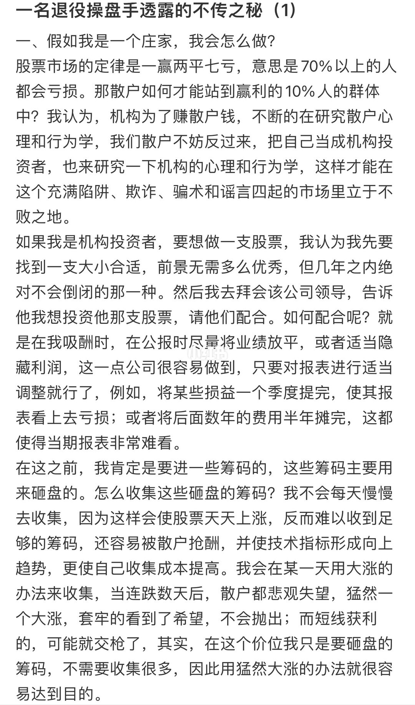
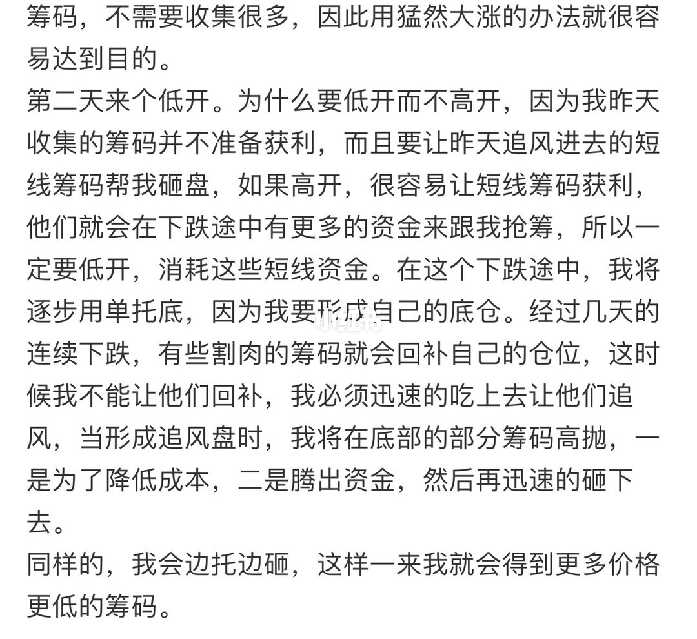
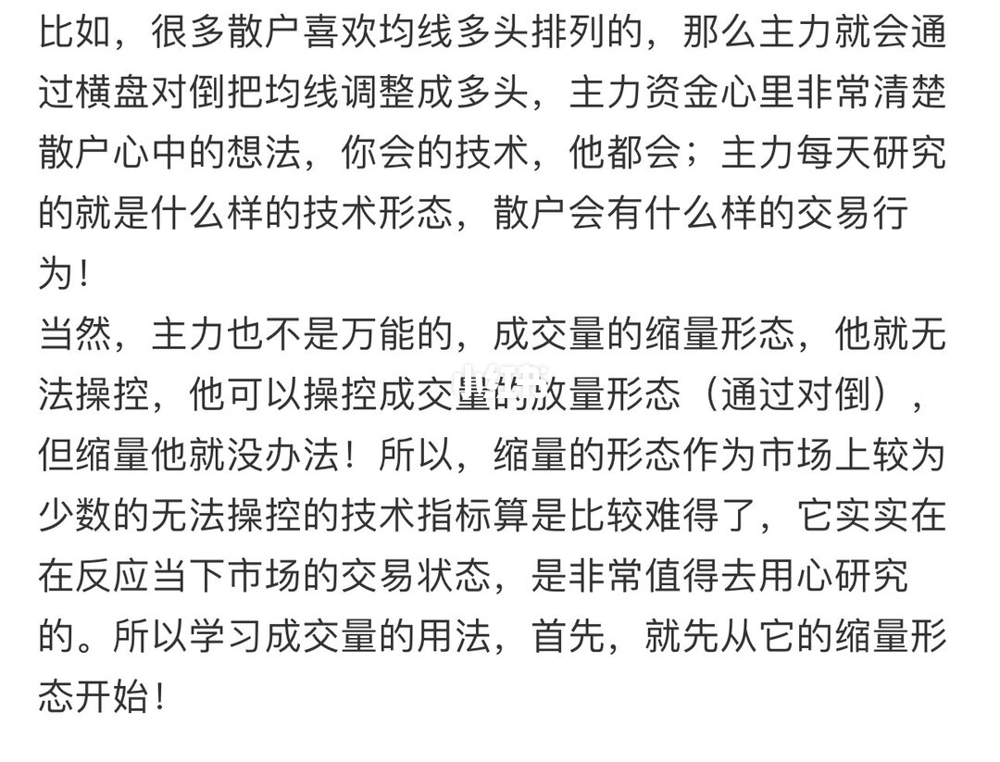
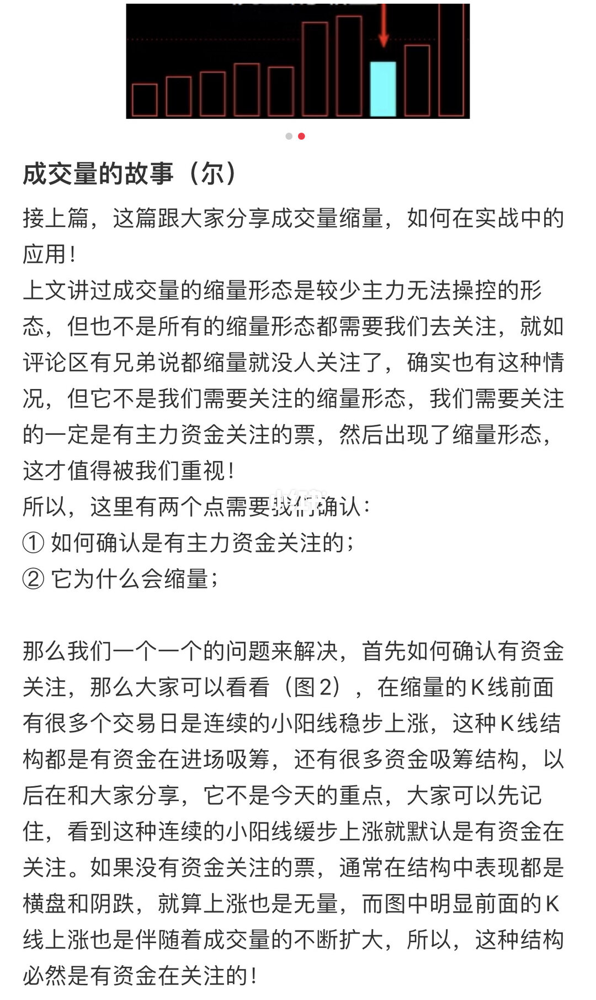
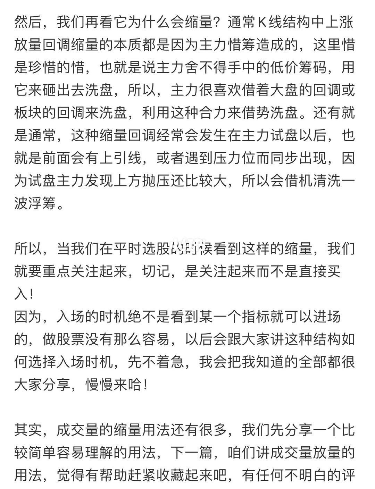
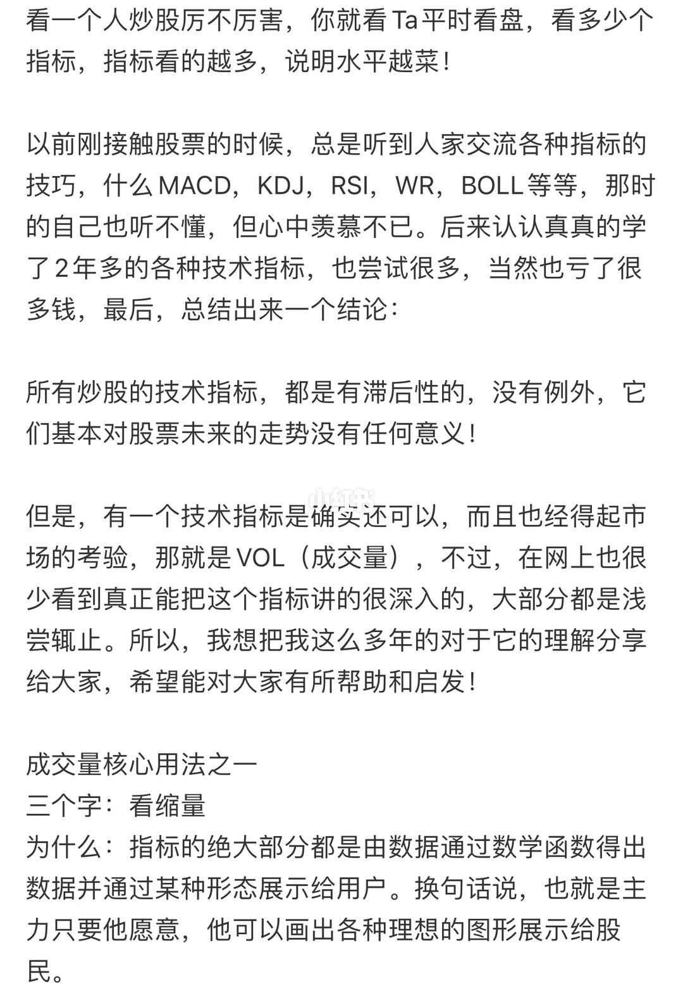

# 有趣的故事——退役操盘手不传之密

> 本文档由小红书笔记归档生成：正文、配图与评论。

## 笔记信息

- **标题**：有趣的故事——退役操盘手不传之密
- **作者**：忠于好奇（userId: `5d40f3fb0000000016035b9a`）
- **笔记 ID**：`6a52163200000000060200a2`
- **发布时间**：2026-07-11 18:08
- **互动数据**：点赞 91 · 收藏 131 · 评论 3 · 分享 33
- **原链接**：http://xhslink.cn/o/9XUpKY5dBGm
- **完整链接**：https://www.xiaohongshu.com/explore/6a52163200000000060200a2?xsec_token=CBKBI-6jrXmWr4sMcALaWuexrZbiyWp_cGsb2lswTyaFw=&xsec_source=app_share

## 正文

蛮有意思的

## 配图（共 6 张）

> 教程/故事正文主要在图片里。下方按笔记原顺序嵌入原图，并附图片文字整理。

### 图片 1

**图片文字整理：**

**一名退役操盘手透露的不传之秘（1）**

### 一、假如我是一个庄家，我会怎么做？

股票市场的定律是一赢两平七亏，意思是 70% 以上的人都会亏损。那散户如何才能站到赢利的 10% 人的群体中？我认为，机构为了赚散户钱，不断在研究散户心理和行为学，我们散户不妨反过来，把自己当成机构投资者，也来研究一下机构的心理和行为学，这样才能在这个充满陷阱、欺诈、骗术和谣言四起的市场里立于不败之地。

如果我是机构投资者，要想做一支股票，我认为我先要找到一支大小合适，前景无需多么优秀，但几年之内绝对不会倒闭的那一种。然后我去拜会该公司领导，告诉他我想投资他那支股票，请他们配合。如何配合呢？就是在我吸筹时，在公报时尽量将业绩放平，或者适当隐藏利润，这一点公司很容易做到，只要对报表进行适当调整就行了，例如，将某些损益一个季度提完，使其报表看上去亏损；或者将后面数年的费用半年摊完，这都使得当期报表非常难看。

在这之前，我肯定是要进一些筹码的，这些筹码主要用来砸盘的。怎么收集这些砸盘的筹码？我不会每天慢慢去收集，因为这样会使股票天天上涨，反而难以收到足够的筹码，还容易被散户抢筹，并使技术指标形成向上趋势，更使自己收集成本提高。我会在某一天用大涨的办法来收集，当连跌数天后，散户都悲观失望，猛然一个大涨，套牢的看到了希望，不会抛出，而短线获利的，可能就交枪了，其实，在这个价位我只是要砸盘的筹码，不需要收集很多，因此用猛然大涨的办法就很容易达到目的。

### 图片 2

**图片文字整理：**

筹码，不需要收集很多，因此用猛然大涨的办法就很容易达到目的。

第二天来个低开。为什么要低开而不高开，因为我昨天收集的筹码并不准备获利，而且要让昨天追风进去的短线筹码帮我砸盘，如果高开，很容易让短线筹码获利，他们就会在下跌途中有更多的资金来跟我抢筹，所以一定要低开，消耗这些短线资金。在这个下跌途中，我将逐步用单托底，因为我要形成自己的底仓。经过几天的连续下跌，有些割肉的筹码就会回补自己的仓位，这时候我不能让他们回补，我必须迅速的吃上去让他们追风，当形成追风盘时，我将在底部的部分筹码高抛，一是为了降低成本，二是腾出资金，然后再迅速的砸下去。

同样的，我会边托边砸，这样一来我就会得到更多价格更低的筹码。

### 图片 3

**图片文字整理：**

比如，很多散户喜欢均线多头排列的，那么主力就会通过横盘对倒把均线调整成多头，主力资金心里非常清楚散户心中的想法，你会的技术，他都会；主力每天研究的就是什么样的技术形态，散户会有什么样的交易行为！

当然，主力也不是万能的，成交量的缩量形态，他就无法操控，他可以操控成交量的放量形态（通过对倒），但缩量他就没办法！所以，缩量形态作为市场上较为少数的无法操控的技术指标算是比较难得了，它实实在在反应当下市场的交易状态，是非常值得去用心研究的。所以学习成交量的用法，首先，就先从它的缩量形态开始！

### 图片 4

**图片文字整理：**

**成交量的故事（二）**

接上篇，这篇跟大家分享成交量缩量，如何在实战中的应用！

上文讲过成交量的缩量形态是较少主力无法操控的形态，但也不是所有的缩量形态都需要我们去关注，就如评论区有兄弟说都缩量就没人关注了，确实也有这种情况，但它不是我们需要关注的缩量形态，我们需要关注的一定是有主力资金关注的票，然后出现了缩量形态，这才值得被我们重视！

所以，这里有两个点需要我们确认：

1. 如何确认是有主力资金关注的；
2. 它为什么会缩量；

那么我们一个一个的问题来解决，首先如何确认有资金关注，那么大家可以看看（图2），在缩量的K线前面有很多个交易日是连续的小阳线稳步上涨，这种K线结构都是有资金在进场吸筹，还有很多资金吸筹结构，以后再和大家分享，它不是今天的重点，大家可以先记住，看到这种连续的小阳线缓步上涨就默认是有资金在关注。如果没有资金关注的票，通常在结构中表现都是横盘和阴跌，就算上涨也是无量，而图中明显前面的K线上涨也是伴随着成交量的不断扩大，所以，这种结构必然是有资金在关注的！

（附图：成交量柱状图，红色箭头指向缩量柱）

### 图片 5

**图片文字整理：**

然后，我们再看它为什么会缩量？通常K线结构中上涨放量回调缩量的本质都是因为主力惜筹造成的，这里惜是珍惜的惜，也就是说主力舍不得手中的低价筹码，用它来砸出去洗盘，所以，主力很喜欢借着大盘的回调或板块的回调来洗盘，利用这种合力来借势洗盘。还有就是通常，这种缩量回调经常会发生在主力试盘以后，也就是前面会有上引线，或者遇到压力位而同步出现，因为试盘主力发现上方抛压还比较大，所以会借机清洗一波浮筹。

所以，当我们在平时选股的时候看到这样的缩量，我们就要重点关注起来，切记，是关注起来而不是直接买入！

因为，入场的时机绝不是看到某一个指标就可以进场的，做股票没有那么容易，以后会跟大家讲这种结构如何选择入场时机，先不着急，我会把我知道的全部都跟大家分享，慢慢来哈！

其实，成交量的缩量用法还有很多，我们先分享一个比较简单容易理解的用法，下一篇，咱们讲成交量放量的用法，觉得有帮助赶紧收藏起来吧，有任何不明白的评……

### 图片 6

**图片文字整理：**

看一个人炒股厉不厉害，你就看 Ta 平时看盘，看多少个指标，指标看的越多，说明水平越菜！

以前刚接触股票的时候，总是听到人家交流各种指标的技巧，什么 MACD，KDJ，RSI，WR，BOLL 等等，那时的自己也听不懂，但心中羡慕不已。后来认认真真的学了 2 年多的各种技术指标，也尝试很多，当然也亏了很多钱，最后，总结出来一个结论：

所有炒股的技术指标，都是有滞后性的，没有例外，它们基本上对股票未来的走势没有任何意义！

但是，有一个技术指标是确实还可以，而且也经得起市场的考验，那就是 VOL（成交量），不过，在网上也很少看到真正能把这个指标讲的很深入的，大部分都是浅尝辄止。所以，我想把我这么多年的对于它的理解分享给大家，希望能对大家有所帮助和启发！

### 成交量核心用法之一

三个字：看缩量

为什么：指标的绝大部分都是由数据通过数学函数得出数据并通过某种形态展示给用户。换句话说，也就是主力只要他愿意，他可以画出各种理想的图形展示给股民。

## 评论

> 官方显示共 **3** 条评论；本次抓取到 **3** 条（`hasMore=False`）。

### 1. 走太远再也回不去了

*2026-07-12 00:27 · IP:河北 · 赞:0*

期待后续

### 2. 小白杨教练心理对话平台

*2026-07-11 22:32 · IP:山西 · 赞:0*

很有收获，期待续作。

### 3. 可可梦

*2026-07-11 22:06 · IP:辽宁 · 赞:0*

写的很好，非常用心，期待续作！

---

## 归档说明

- 图片保存在 `images/` 目录（`01.jpg`–`06.jpg`）。
- 原始评论 JSON 保存在 `comments/` 目录。
- 图片文字由 OCR + 人工校对整理，个别 OCR 错字已按语义修正（如「吸筹」「砸盘」「浅尝辄止」等）。
- 归档时间：2026-07-26 00:57:57 +0800
